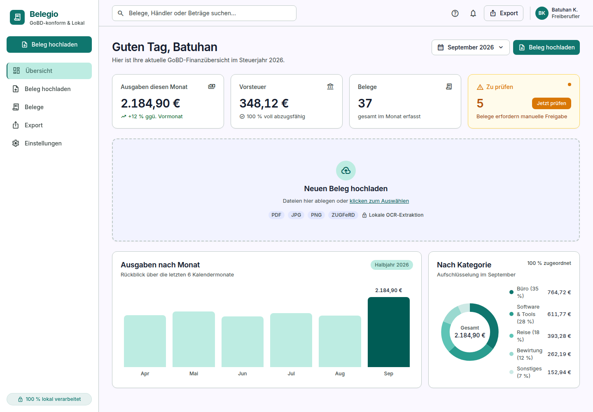
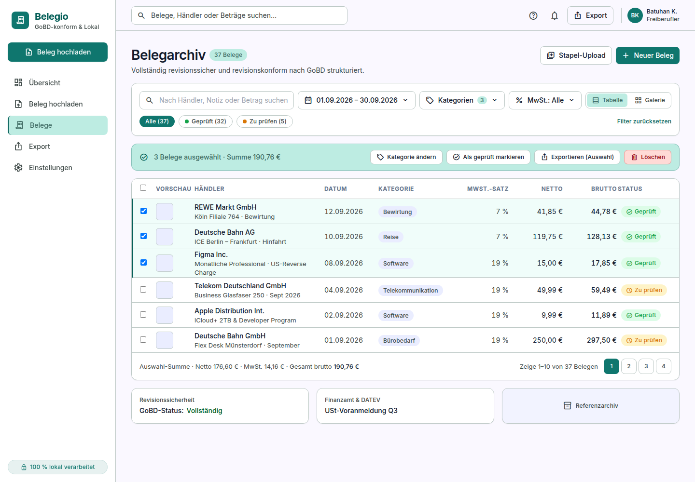
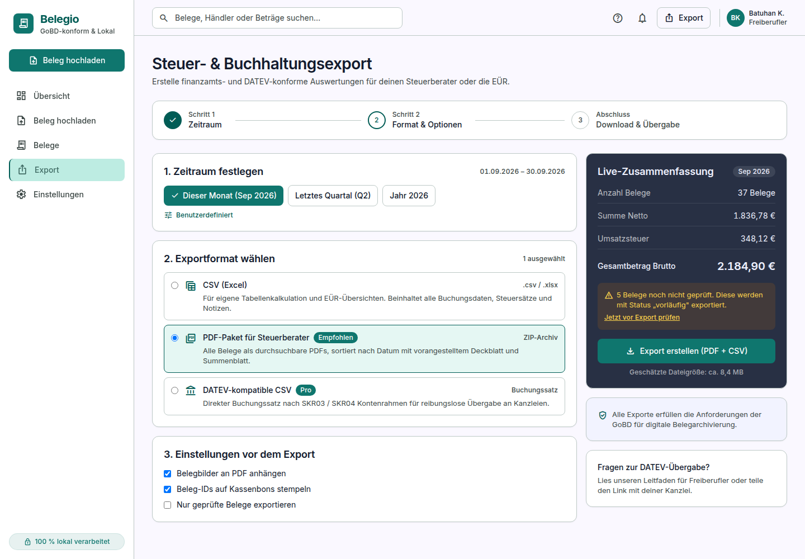

<div align="center">

# Belegio

**Receipt scanning and tax export for German freelancers — entirely in your browser.**

Belegio digitises receipts and invoices, extracts the tax-relevant fields, and
produces GoBD-compliant exports for your accountant. OCR runs client-side via
WebAssembly, so your receipts never leave your machine.

[](#development)
[](#security)
[](https://react.dev)
[](https://www.typescriptlang.org)
[](https://vite.dev)
[](LICENSE)

</div>

---

> [!NOTE]
> **Project status: early.** Upload and OCR work end to end on the dashboard —
> drop in a receipt photo and it is read, parsed and stored locally. The other
> screens still render placeholder data, and export is not implemented yet.
> See the [roadmap](#roadmap).

---

## Screenshots

### Dashboard


### Receipt archive


### Tax export


---

## Why Belegio

German bookkeeping rules ([GoBD][gobd]) require receipts to be archived in a
complete, unalterable and traceable way. Most tools solve this by uploading your
receipts to a server — which means handing your tax records to a third party.

Belegio takes the opposite approach: **everything runs locally.** Receipts are
processed in the browser and never transmitted anywhere. The application code
makes no network calls at all.

| | |
|---|---|
| **Local-first** | OCR and extraction run in-browser through WebAssembly |
| **GoBD-oriented** | Structured for complete, auditable receipt archiving |
| **DATEV-ready** | Exports to SKR03 / SKR04 for handover to your accountant |
| **VAT aware** | Handles 19 % / 7 % / 0 %, input tax and gross/net validation |
| **German UI** | Written for German tax workflows, `de-DE` formatting throughout |

[gobd]: https://www.bundesfinanzministerium.de/Content/DE/Downloads/BMF_Schreiben/Weitere_Steuerthemen/Abgabenordnung/2019-11-28-GoBD.html

---

## Screens

| Route | Screen | What it does |
|---|---|---|
| `/` | **Übersicht** | KPIs from your real receipts, plus **working upload + OCR** |
| `/upload` | **Beleg hochladen** | Batch upload with a 4-stage pipeline: crop → OCR → extract → verify |
| `/pruefen` | **Beleg prüfen** | Scan viewer beside extracted fields, with per-field confidence |
| `/belege` | **Belegarchiv** | Filterable archive, bulk actions, VAT and totals |
| `/export` | **Export** | Three-step wizard: period → format → options |
| `/einstellungen` | **Einstellungen** | Placeholder — not yet designed |

---

## Getting started

Requires **Node.js 20+** (developed against Node 24).

```bash
git clone https://github.com/<your-username>/belegio.git
cd belegio

npm install
npm run dev          # http://localhost:5173
```

### Scripts

| Command | Purpose |
|---|---|
| `npm run dev` | Development server with hot reload |
| `npm run build` | Type-check and build to `dist/` |
| `npm run preview` | Serve the production build locally |

---

## Tech stack

- **React 18** + **TypeScript 5.9** in strict mode
- **Vite 8** for builds
- **Tailwind CSS 3** with design tokens generated from the source design system
- **React Router 7** for routing

No state library, chart library or component framework — the charts are
hand-written SVG, keeping the dependency surface small (an explicit goal for an
application that handles tax data).

---

## Project structure

```
belegio/
├── design/            Reference designs (screenshots, HTML, DESIGN.md)
├── docs/              Screenshots used by this README
├── src/
│   ├── components/    Layout, Sidebar, Topbar, Card, StatusChip, Icon
│   ├── pages/         The five screens
│   ├── lib/           de-DE formatting + placeholder data
│   └── router.tsx
└── tailwind.config.js Design tokens (generated, not hand-edited)
```

### Design system

The visual language comes from a design system named **“Precision Fiscal”**:
teal `#0F766E`, Inter, 12 px corner radius, tabular figures for all monetary
values. Tokens live in [`tailwind.config.js`](tailwind.config.js) and are
generated from the design export rather than written by hand — see
[`design/README.md`](design/README.md) before changing colours.

---

## Security

Because Belegio is intended to handle tax records, a few rules are enforced:

- **No secrets in the repository.** `.mcp.json`, `.env` and `providers.json` are
  gitignored; `.mcp.json.example` shows the shape without the values.
- **No receipt data in the repository.** `belege/`, `uploads/`, `scans/` and
  `exports/` are gitignored.
- **Receipts are never uploaded.** OCR runs in a local WebAssembly worker.
  The only outbound requests are Tesseract's worker script and German language
  model, fetched once from a CDN and then cached by the browser; receipt images
  and extracted data never leave the machine.
- **No `dangerouslySetInnerHTML`, `eval` or `innerHTML`** assignments.
- **Zero dependency vulnerabilities** — verified with `npm audit`.

If you find a security problem, please open a private security advisory rather
than a public issue.

---

## Roadmap

- [x] OCR with `tesseract.js` in a Web Worker
- [x] Persistence via IndexedDB (receipts + images)
- [ ] Wire the archive, review and upload screens to stored data
- [ ] PDF receipt support
- [ ] Real exports: CSV, PDF bundle, DATEV (SKR03 / SKR04)
- [ ] ZUGFeRD / XRechnung parsing
- [ ] Settings screen
- [ ] Automated tests

---

## Contributing

Issues and pull requests are welcome. Please run `npm run build` before opening a
PR — the build type-checks in strict mode and must pass.

Note that the UI is German by design; user-facing strings should stay in German,
while code, comments and documentation are in English.

---

## Licence

[MIT](LICENSE)
