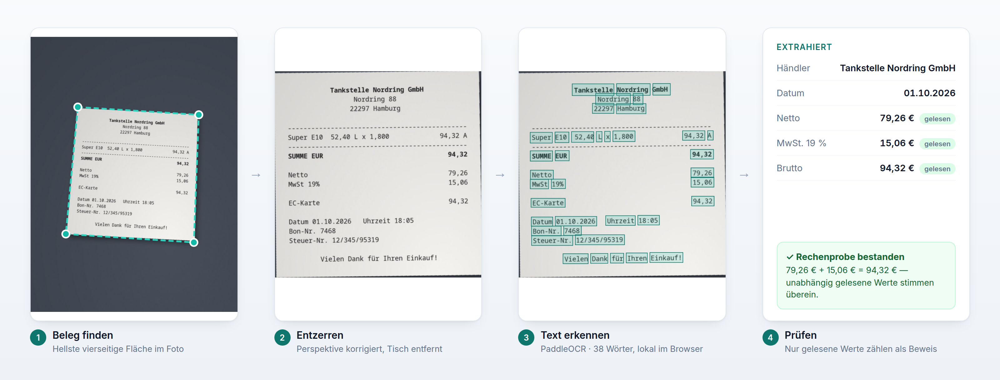
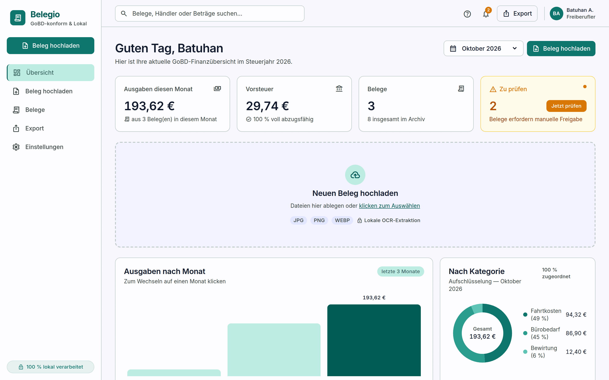
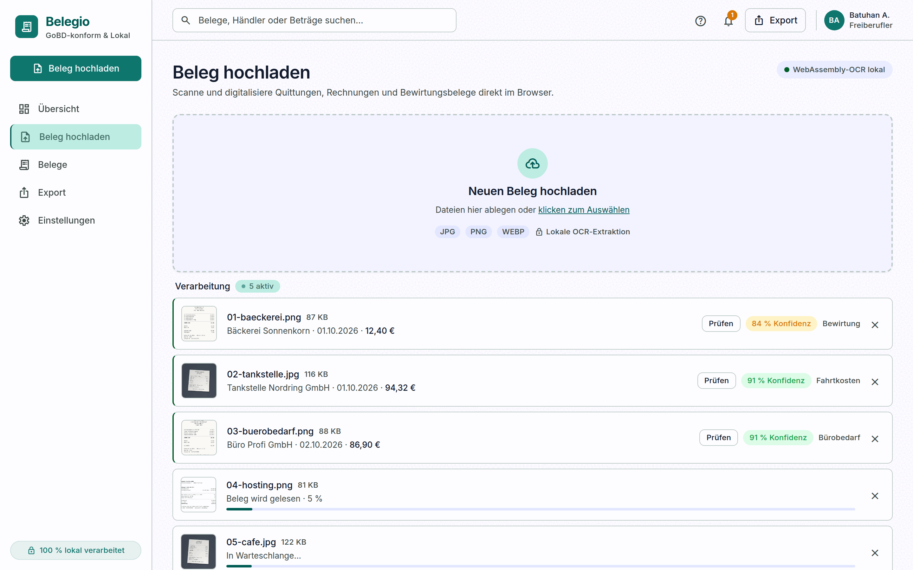
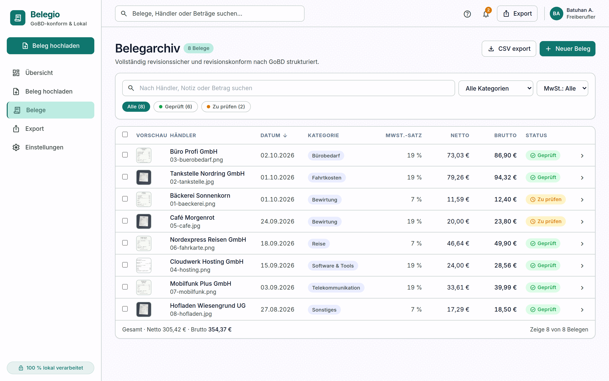
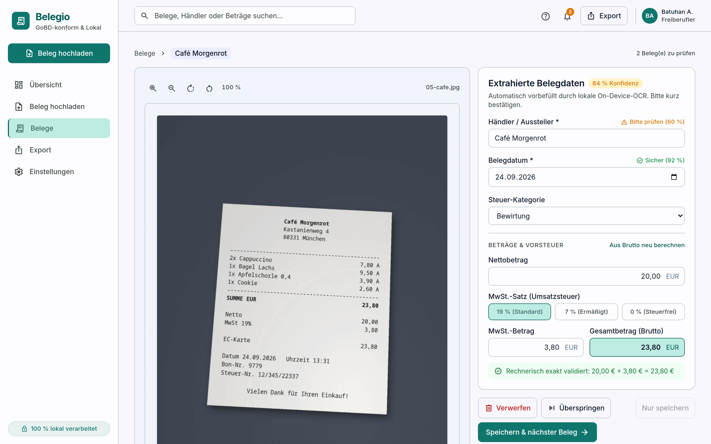
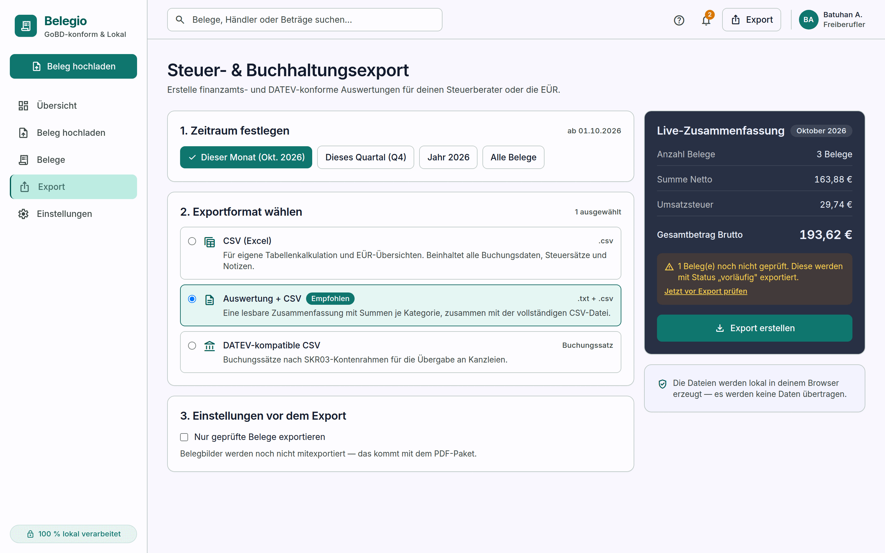

<div align="center">

# 🧾 Belegio

### Receipt scanning and tax export for German freelancers. Entirely in your browser.

Photograph a receipt. Belegio finds it, straightens it, reads it, checks the
maths and files it, **without the image ever leaving your computer.**

[](#-testing)
[](#-privacy--security)
[](#-privacy--security)
[](https://react.dev)
[](https://www.typescriptlang.org)
[](LICENSE)

<br>



<sub>Every step above runs on your device. The receipt shown is one of the fictional samples in <a href="samples/"><code>samples/</code></a>.</sub>

</div>

---

## ✨ What it does

- **📸 Reads phone photos.** It finds the receipt on the table, corrects the perspective and reads the text with **PaddleOCR**, a deep-learning OCR engine running in WebAssembly.
- **🧮 Checks the maths.** Net + VAT must equal the total, using figures that were *actually read*. Anything that doesn't add up goes to you for review. It never guesses silently.
- **🗂️ Organises everything.** Archive with search, filters and bulk actions. Categories are assigned automatically and you can change them.
- **📤 Exports for your accountant.** CSV, a readable summary, and a DATEV-style booking batch (SKR03).
- **🔒 Stays private.** No server, no account, no tracking. Receipts live in your browser's IndexedDB.

> [!NOTE]
> The interface is in **German**, because it is built for German tax workflows (GoBD, Vorsteuer, DATEV). The code and documentation are in English.

---

## 📷 Screenshots

### Übersicht (dashboard)
Monthly spending, deductible input tax and receipts waiting for review, all computed from your stored receipts.



<table>
<tr>
<td width="50%">

**Upload:** drop several files at once; each is read in turn



</td>
<td width="50%">

**Archive:** search, filter by category, VAT rate or status



</td>
</tr>
<tr>
<td width="50%">

**Review:** the scan beside the extracted fields, with a confidence for each field



</td>
<td width="50%">

**Export:** choose a period and format, with a live summary



</td>
</tr>
</table>

---

## 🔍 How a receipt is read

```
 Photo ─► 1. Find & straighten ─► 2. PaddleOCR ─► 3. Parse fields ─► 4. Verify ─► IndexedDB
                                   │ (figures don't add up?)
                                   └─► Tesseract as a second opinion
```

| Step | What happens | Where |
|---|---|---|
| **1. Find & straighten** | The receipt is the brightest four-cornered region in the photo. Its corners are mapped onto an upright rectangle (perspective correction). If nothing paper-like is found, nothing is cropped. | [`rectify.ts`](src/lib/rectify.ts) |
| **2. Read** | **PaddleOCR PP-OCRv5** runs in a Web Worker via ONNX Runtime Web: a detector finds the text lines, a recogniser reads them (Latin script incl. `ä ö ü ß €`). | [`paddleWorker.ts`](src/lib/paddleWorker.ts) |
| **3. Parse** | Finds merchant, date, net, VAT and total, and tolerates typical OCR damage (`Zuischensumme`, `4S,8O`). Tax tables (`Steuer │ Netto │ Brutto`) are matched by column. | [`parseReceipt.ts`](src/lib/parseReceipt.ts) |
| **4. Verify** | Only figures read from the receipt count as evidence: net + VAT = total, or VAT matches the printed rate to within half a cent. Receipts that pass with high confidence are approved automatically; everything else waits for you. | [`parseReceipt.ts`](src/lib/parseReceipt.ts) |

If PaddleOCR's figures don't add up, **Tesseract** reads the receipt again as an independent second opinion. The read with the best evidence wins.

**Measured accuracy** (fields: merchant, date, net, VAT, total, rate):

| Test set | Fields correct | Amounts correct | Wrong amount auto-approved |
|---|---|---|---|
| 8 fictional samples in [`samples/`](samples/) (5 scans, 3 photos) | **48 / 48** | 24 / 24 | 0 |
| 2 real receipts + 8 synthetic photos, from sharp to blurry | **57 / 60** | 30 / 30 | 0 |

The three misses are dates on very blurry, low-resolution photos, where `0` and `8` can't be told apart. Those receipts get today's date, marked as *guessed*, and go to review. These are small test sets. Real-world accuracy on curled, faded thermal paper will be lower.

---

## 🚀 Getting started

Requires **Node.js 20+**.

```bash
git clone https://github.com/<your-username>/belegio.git
cd belegio
npm install
npm run dev            # → http://localhost:5173
```

The first `npm run dev` downloads the OCR models (~13 MB) into `public/models/` and checks their SHA-256 checksums. After that, everything works offline except Tesseract's language model, which is fetched once and then cached by the browser.

**Try it:** drag the files from [`samples/`](samples/) onto the Übersicht page.

| Command | Purpose |
|---|---|
| `npm run dev` | Development server with hot reload and the developer inspector |
| `npm run build` | Type-check and build to `dist/` |
| `npm run preview` | Serve the production build |
| `npm test` | Run the unit tests |
| `npm run models` | Download and verify the OCR models (runs automatically) |

> [!TIP]
> In `npm run dev`, click any receipt under *Gespeicherte Belege* on the dashboard to open the **developer inspector**. It shows each field's source (*read / calculated / guessed / missing*), the receipt line it came from, every OCR pass, and the raw OCR text. It is not included in production builds.

---

## 🔒 Privacy & security

Belegio handles tax records, so a few rules are enforced:

- **Receipts are never uploaded.** OCR runs in local WebAssembly workers. The PaddleOCR models and the ONNX runtime are served by the app itself. The only external request is Tesseract's German language model (~2 MB, once).
- **Pinned models.** [`scripts/fetch-models.mjs`](scripts/fetch-models.mjs) rejects any model file whose SHA-256 checksum doesn't match the pinned value.
- **No secrets or receipt data in the repository.** `.env*`, `.mcp.json`, `belege/`, `uploads/`, `scans/` and `exports/` are gitignored. The images in `samples/` are invented.
- **No `dangerouslySetInnerHTML`, `eval` or `innerHTML`.**
- **Zero known dependency vulnerabilities** (`npm audit`).

> [!WARNING]
> Because everything is stored in your browser, **clearing your browser data deletes your receipts.** Back up regularly via *Einstellungen → Daten als CSV sichern*. Belegio supports GoBD-oriented record keeping, but it is not a certified archiving system. Check with your tax advisor.

If you find a security problem, please open a private security advisory instead of a public issue.

---

## 🧱 Tech stack

| | |
|---|---|
| **UI** | React 18 · TypeScript (strict) · Vite 8 · Tailwind CSS 3 · React Router 7 |
| **OCR** | [PaddleOCR PP-OCRv5](https://github.com/PaddlePaddle/PaddleOCR) via [ONNX Runtime Web](https://onnxruntime.ai/) · [Tesseract.js](https://github.com/naptha/tesseract.js) |
| **Image processing** | Receipt detection, Otsu thresholding and the perspective warp in plain TypeScript (no OpenCV) |
| **Storage** | IndexedDB via [`idb`](https://github.com/jakearchibald/idb) |
| **Tests** | Node's built-in test runner via `tsx` |

There is no state library, component framework or chart library: the charts are hand-written SVG. Keeping third-party code small is a deliberate choice for an app that handles tax data.

<details>
<summary><b>Project structure</b></summary>

```
belegio/
├── samples/              Fictional demo receipts to try the app with
├── scripts/              Model download (checksum-pinned), sample generator
├── docs/                 Screenshots for this README
├── design/               Reference designs and the "Precision Fiscal" design system
└── src/
    ├── pages/            Übersicht, Upload, Belege, Prüfen, Export, Einstellungen
    ├── components/       Layout, upload dropzone, developer inspector, …
    └── lib/
        ├── rectify.ts        find the receipt + perspective warp
        ├── preprocess.ts     decode, straighten, grayscale for Tesseract
        ├── readReceipt.ts    reading passes, choosing the best read
        ├── paddle*.ts        PaddleOCR worker (detector + recogniser)
        ├── textBoxes.ts      OCR geometry: boxes, CTC decoding, line grouping
        ├── ocr.ts            Tesseract worker
        ├── parseReceipt.ts   text → fields, verification
        ├── db.ts · store.ts  IndexedDB storage and shared state
        └── exporters.ts      CSV, summary, DATEV-style batch
```

</details>

---

## 🧪 Testing

```bash
npm test
```

38 unit tests cover the parser, receipt detection and the OCR geometry. Many of them are regressions taken from real misreads:

- an OCR-damaged `Zwischensumme` being taken as the total
- a misread total (`89,58` instead of `89,50`) that matched the VAT rate but not net + VAT
- a tax table where every label grabbed the last figure in the row
- a date glued to the time (`04.01.202010:14:40`)
- a tilted photo where the label and the amount ended up on different lines

---

## 🗺️ Roadmap

- [x] Local OCR with PaddleOCR and Tesseract
- [x] Receipt detection and perspective correction
- [x] Verification using independently read figures only
- [x] Archive, review, export and settings screens
- [x] CSV and DATEV-style export (SKR03)
- [ ] Several VAT rates on one receipt (7 % **and** 19 %)
- [ ] PDF invoices via text extraction (no OCR needed)
- [ ] ZUGFeRD / XRechnung e-invoices
- [ ] Receipt images in the export (PDF bundle)
- [ ] Blur warning while taking the photo

---

## 🤝 Contributing

Issues and pull requests are welcome. Before opening a PR, please run:

```bash
npm test && npm run build
```

User-facing text stays in German, while code, comments and docs are in English. Design tokens in [`tailwind.config.js`](tailwind.config.js) are generated from the design export. See [`design/README.md`](design/README.md) before changing colours.

## 📄 Licence

[MIT](LICENSE) © Belegio contributors

Third-party models, downloaded at build time and not part of this repository: PaddleOCR PP-OCRv5 (© PaddlePaddle Authors) and the Tesseract language data are both licensed under **Apache 2.0**.
